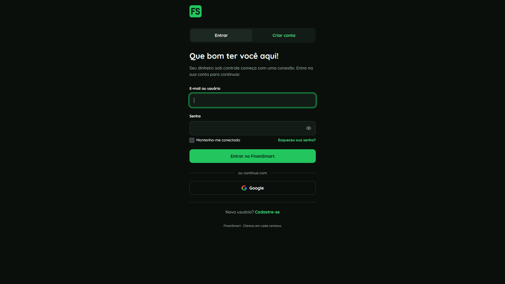
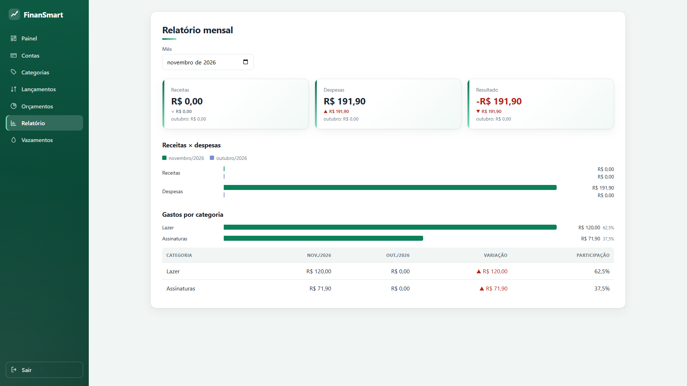
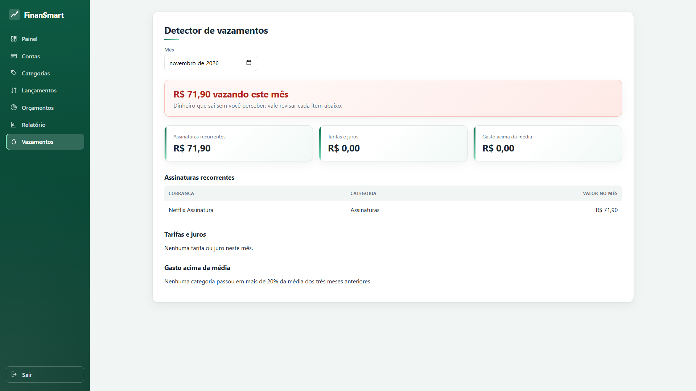

# FinanSmart

Aplicação web de finanças pessoais para organizar contas, lançamentos, orçamentos e descobrir gastos que passam despercebidos.

O projeto foi construído como um monorepo com API Spring Boot, aplicação Angular, PostgreSQL e Keycloak. O MVP inclui autenticação, contas, categorias, lançamentos, saldo, painel, orçamentos, relatório mensal, detector de vazamentos e dados de demonstração.

## Funcionalidades

- Login, cadastro e logout pelo Keycloak com PKCE.
- Contas correntes, poupança, carteira e investimentos, com arquivamento.
- Categorias do sistema e categorias personalizadas.
- Receitas e despesas com filtros por período, conta e categoria.
- Saldo por conta e painel com resumo financeiro.
- Orçamentos mensais com alertas em 80% e 100%.
- Relatório mensal com comparação, participação por categoria e gráficos.
- Detector de assinaturas, tarifas, juros e gastos acima da média.
- Perfil demo com seis meses de dados realistas.

## Telas

| Login | Relatório mensal | Detector de vazamentos |
|---|---|---|
|  |  |  |

As capturas mostram a interface durante o desenvolvimento. Para experimentar os detectores com uma base fictícia reproduzível, consulte o [perfil demo](docs/demo.md).

## Arquitetura

```text
Angular 22 (localhost:4200)
        │ Authorization Code + PKCE
        ▼
Keycloak (localhost:8180) ── JWT ──► Spring Boot API (localhost:8080)
                                           │
                                           ▼
                                      PostgreSQL (5432)
```

O Angular mantém o access token em memória e envia o bearer token apenas para a API. O Spring Boot funciona como OAuth2 Resource Server e usa o claim `sub` do token como proprietário dos dados. O banco não possui tabela de usuários.

As decisões principais estão em [docs/adr](docs/adr). O contrato da API está disponível no [guia do Swagger](docs/api.md).

## Pré-requisitos

- Docker Desktop com Compose.
- Java 17 ou um JDK compatível para executar o build.
- Node.js 20+ e npm.
- Git.

## Executar localmente

Na raiz do projeto, suba PostgreSQL e Keycloak:

```powershell
docker compose up -d
```

Em outro terminal, inicie a API:

```powershell
Set-Location server
.\mvnw.cmd spring-boot:run
```

Em um terceiro terminal, inicie o Angular:

```powershell
Set-Location web
npm install
npm start
```

Abra http://localhost:4200. Para o ambiente local, use `demo` / `demo`. O console administrativo do Keycloak fica em http://localhost:8180, com `admin` / `admin`.

O realm, o cliente público, o tema preto e verde e o usuário demo são importados pelo Compose. O botão do Google só funciona quando `GOOGLE_CLIENT_ID` e `GOOGLE_CLIENT_SECRET` estão preenchidos no `.env`; esse arquivo nunca deve ser commitado.

## Ambiente demo

O perfil demo usa uma base PostgreSQL exclusiva e executa a carga de seis meses uma única vez. Consulte [docs/demo.md](docs/demo.md) para configurar `DB_URL`, `KEYCLOAK_ISSUER_URI`, `DEMO_USER_ID` e `CORS_ALLOWED_ORIGINS`.

## Testes e build

API, usando Testcontainers:

```powershell
Set-Location server
.\mvnw.cmd verify
```

Frontend:

```powershell
Set-Location web
npm test -- --watch=false
npm run build
```

O build da API executa os testes unitários e de integração com PostgreSQL temporário. Os testes do Angular usam Vitest.

## API

Com a API em execução:

- Swagger UI: http://localhost:8080/swagger-ui/index.html
- OpenAPI JSON: http://localhost:8080/v3/api-docs
- Health check: http://localhost:8080/actuator/health

Consulte [docs/api.md](docs/api.md) para autenticação, exemplos, formatos de data e erros.

## Estado do projeto

O MVP funcional está concluído até T-11. Este repositório apresenta o código, a documentação e instruções para execução local como projeto de portfólio.

## Licença

Projeto de portfólio de Leonardo Augusto Alves.
